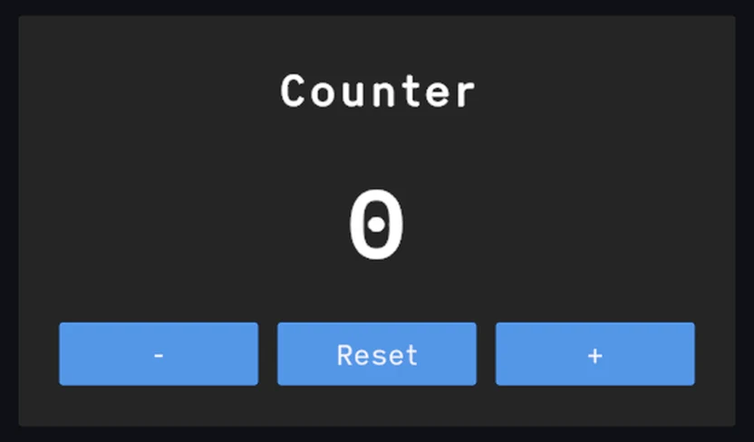
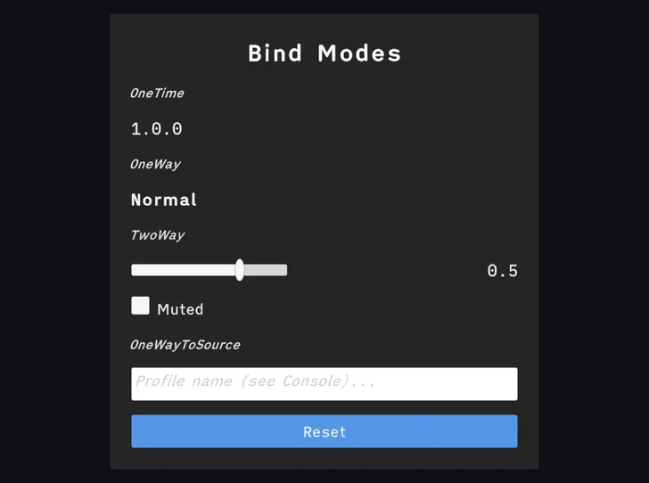
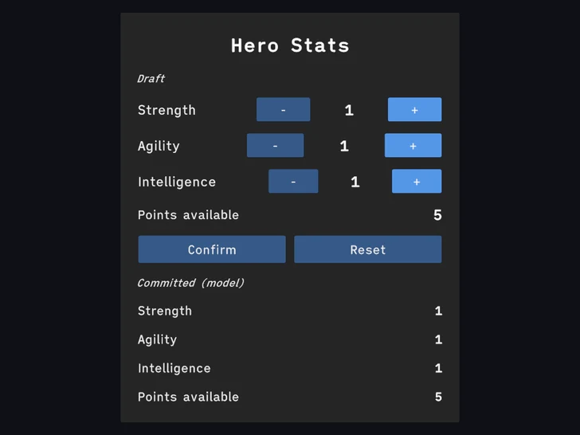
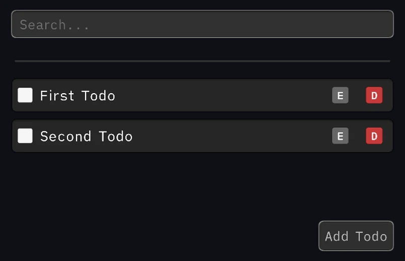
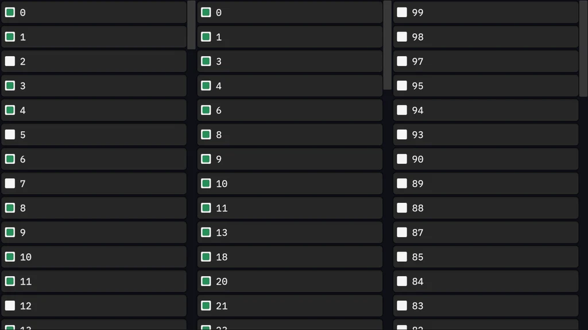
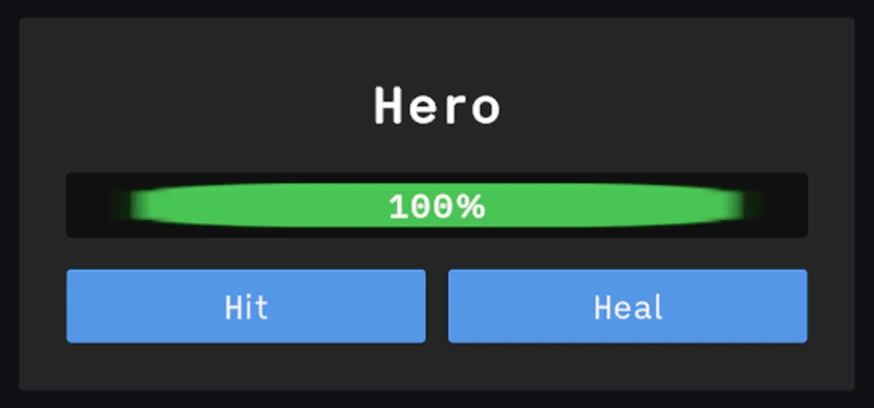
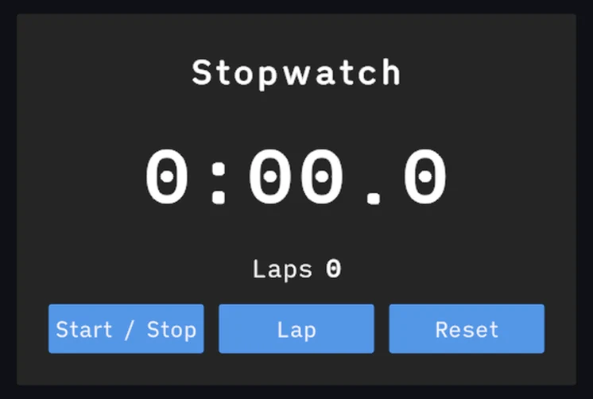
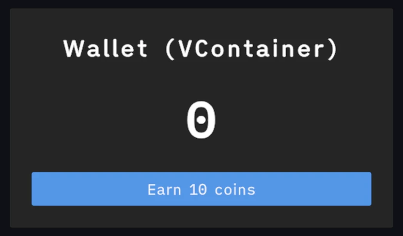

<picture>
  <source srcset="Docs/static/img/readme/aspid_mvvm_readme_banner_dark.webp" />
  
</picture>

[](#preview-via-git)
[](https://github.com/VPDPersonal/Aspid.MVVM/releases/tag/v1.0.5)
[](https://github.com/VPDPersonal/Aspid.MVVM/releases/tag/v1.1.0-beta.1)
[](LICENSE)

Aspid.MVVM is an MVVM framework for Unity. Bind UI to C# ViewModels, wire buttons to commands, and keep lists in sync as data changes. Source generators produce the binding code at compile time so bindings run without reflection.

[Documentation in English](https://vpdpersonal.github.io/Aspid.MVVM/docs) · [Документация на русском](https://vpdpersonal.github.io/Aspid.MVVM/ru/docs)

## Installation

### Stable

Get Aspid.MVVM from the [Unity Asset Store](https://assetstore.unity.com/packages/slug/298463) and import it from **Window → Package Manager → My Assets**. You can also download the `.unitypackage` from the [latest stable GitHub release](https://github.com/VPDPersonal/Aspid.MVVM/releases/latest) and open it in Unity.

### Preview via Git

Open **Window → Package Manager** and choose **+ → Install package from git URL…**. Paste each URL below and click **Install** before moving to the next one. Install the two dependencies first because Unity Package Manager does not resolve Git dependencies automatically.

**1. Aspid.FastTools**

```text
https://github.com/VPDPersonal/Aspid.FastTools.git#upm-preview
```

**2. Aspid.Collections**

```text
https://github.com/VPDPersonal/Aspid.Collections.git#upm
```

**3. Aspid.MVVM**

```text
https://github.com/VPDPersonal/Aspid.MVVM.git#upm-preview
```

Use **Update** in Package Manager to pull the latest version from the branch. To pin MVVM, use the `upm/<version>` tag for a [published release](https://github.com/VPDPersonal/Aspid.MVVM/releases).

```text
https://github.com/VPDPersonal/Aspid.MVVM.git#upm/1.1.0-beta.1
```

The MVVM preview package declares Unity **6000.0.0f1** as its minimum. With the FastTools dependency above, use Unity **6000.0.53f1** or newer.

<details>
<summary>Troubleshooting</summary>

- **Duplicate assembly names.** If you previously imported MVVM under `Assets`, remove that copy before installing the Git package.
- **Unity cannot resolve `com.unity.test-framework@1.6.0`.** Aspid.Collections 1.1.0 declares that dependency. Check that your Unity version can resolve it. See the [Aspid.Collections installation notes](https://github.com/VPDPersonal/Aspid.Collections#installation).

</details>

## Features

These previews use the sample scenes from the 1.1 series.

### ViewModels, binding and commands

<table>
<tr>
<td width="56%" valign="top"></td>
<td width="44%" valign="top">
<h4><a href="https://vpdpersonal.github.io/Aspid.MVVM/docs/viewmodels">Generated ViewModels</a></h4>
<p>The source generator turns <code>[Bind]</code> fields into bindable properties. The counter display follows its ViewModel as the buttons change the count.</p>
<p><a href="https://vpdpersonal.github.io/Aspid.MVVM/tutorials/counter">Counter tutorial →</a></p>
</td>
</tr>
</table>

<table>
<tr>
<td width="56%" valign="top"></td>
<td width="44%" valign="top">
<h4><a href="https://vpdpersonal.github.io/Aspid.MVVM/docs/binding-modes">Binding modes and converters</a></h4>
<p>Bind a slider both ways so either side can change the volume. A converter maps between the slider position and the stored value.</p>
<p><a href="https://vpdpersonal.github.io/Aspid.MVVM/tutorials/bind-modes">Bind Modes tutorial →</a></p>
</td>
</tr>
</table>

<table>
<tr>
<td width="56%" valign="top"></td>
<td width="44%" valign="top">
<h4><a href="https://vpdpersonal.github.io/Aspid.MVVM/docs/commands">Relay commands</a></h4>
<p>Use <code>[RelayCommand]</code> to turn a method into a button action. Pass the stat as an argument and disable the button when points run out.</p>
<p><a href="https://vpdpersonal.github.io/Aspid.MVVM/tutorials/stats">Stats tutorial →</a></p>
</td>
</tr>
</table>

### Collections

<table>
<tr>
<td width="56%" valign="top"></td>
<td width="44%" valign="top">
<h4><a href="https://vpdpersonal.github.io/Aspid.MVVM/docs/collections">Observable collections</a></h4>
<p>Use <code>CreateSync</code> to turn tasks into row ViewModels. Adding or removing a task updates the list, and search filters the visible rows.</p>
<p><a href="https://vpdpersonal.github.io/Aspid.MVVM/tutorials/todo-list">Todo List tutorial →</a></p>
</td>
</tr>
</table>

<table>
<tr>
<td width="56%" valign="top"></td>
<td width="44%" valign="top">
<h4><a href="https://vpdpersonal.github.io/Aspid.MVVM/docs/StarterKit/collection-binders#virtualizedlistitemsourcebinder">Virtualized lists</a></h4>
<p>Reuse row views while scrolling through large lists. Set filters and sort order in the Inspector.</p>
<p><a href="https://vpdpersonal.github.io/Aspid.MVVM/tutorials/virtualized-list">Virtualized List tutorial →</a></p>
</td>
</tr>
</table>

### Custom components and integration

<table>
<tr>
<td width="56%" valign="top"></td>
<td width="44%" valign="top">
<h4><a href="https://vpdpersonal.github.io/Aspid.MVVM/docs/binders">Custom binders</a></h4>
<p>Bind a custom component such as a health bar. Generate a serializable binder to configure the binding inline in the Inspector.</p>
<p><a href="https://vpdpersonal.github.io/Aspid.MVVM/tutorials/custom-binder">Custom Binder tutorial →</a></p>
</td>
</tr>
</table>

<table>
<tr>
<td width="56%" valign="top"></td>
<td width="44%" valign="top">
<h4><a href="https://vpdpersonal.github.io/Aspid.MVVM/docs/dynamic-viewmodel">Dynamic ViewModels</a></h4>
<p>Add properties and commands by ID at runtime. The stopwatch binds to elapsed time and lap count through those IDs.</p>
<p><a href="https://vpdpersonal.github.io/Aspid.MVVM/tutorials/dynamic-view-model">Dynamic ViewModel tutorial →</a></p>
</td>
</tr>
</table>

<table>
<tr>
<td width="56%" valign="top"></td>
<td width="44%" valign="top">
<h4><a href="https://vpdpersonal.github.io/Aspid.MVVM/docs/di-integration">Dependency injection</a></h4>
<p>Let <code>ViewInitializer</code> resolve a ViewModel from Zenject or VContainer. The wallet receives its model through constructor injection.</p>
<p><a href="https://vpdpersonal.github.io/Aspid.MVVM/tutorials/di-integration">DI Integration tutorial →</a></p>
</td>
</tr>
</table>

## Resources

| [Samples](https://vpdpersonal.github.io/Aspid.MVVM/tutorials/) | [API reference](https://vpdpersonal.github.io/Aspid.MVVM/api/Aspid.MVVM) | [Changelog](CHANGELOG.md) |
| --- | --- | --- |
| Follow the learning path or open a sample from the **Samples** tab in Package Manager. | Look up framework types and members. | See changes by release. |

## Help and support

Found a bug or have a question? Include your Unity version, Aspid.MVVM version, and steps to reproduce.

**[Open an issue](https://github.com/VPDPersonal/Aspid.MVVM/issues)** · [Star on GitHub](https://github.com/VPDPersonal/Aspid.MVVM)

You can also support development through the [Unity Asset Store](https://assetstore.unity.com/packages/slug/298463).
