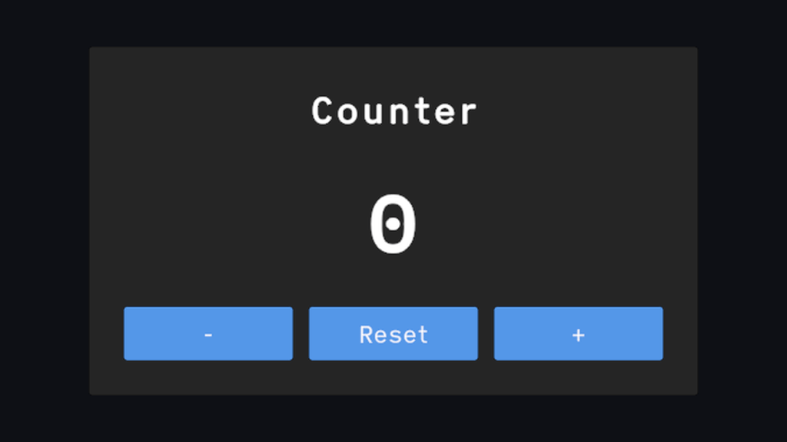
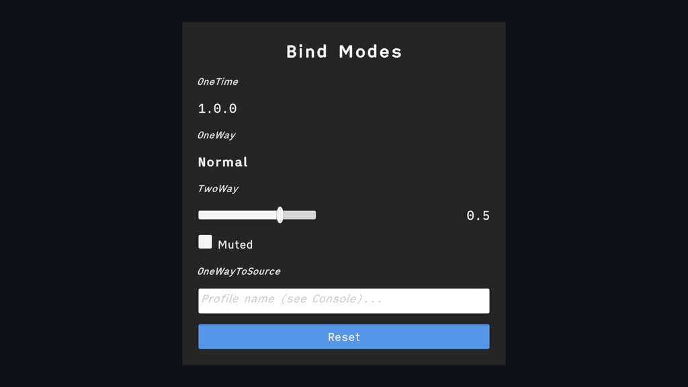
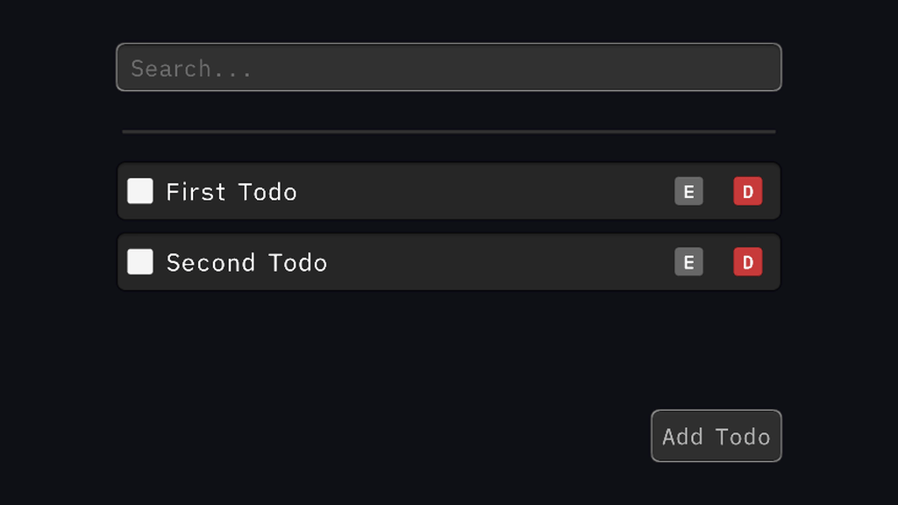
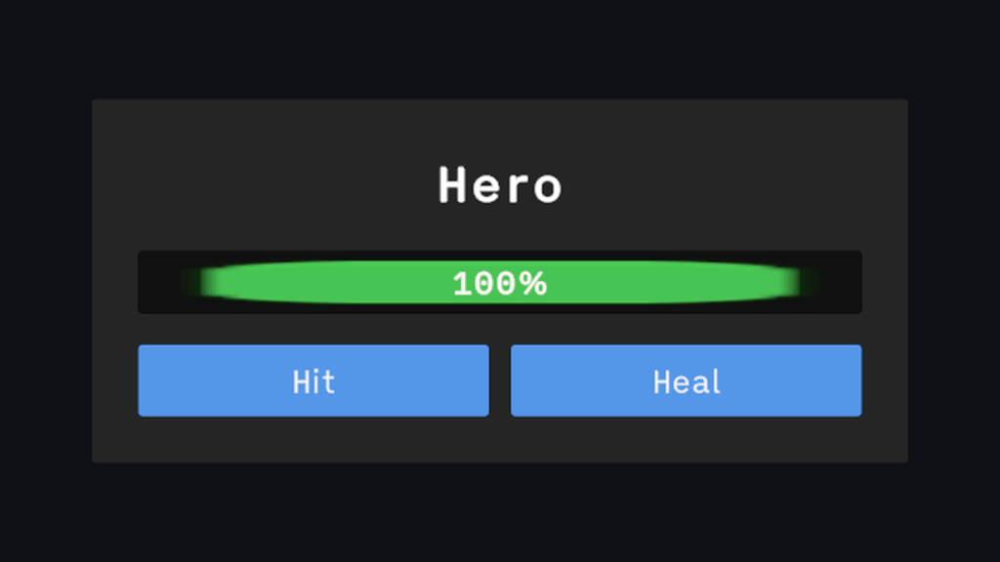

<picture>
  <source srcset="Docs/static/img/readme/aspid_mvvm_readme_banner_dark.webp" />
  
</picture>

[](#preview-via-git)
[](https://github.com/VPDPersonal/Aspid.MVVM/releases/tag/v1.0.5)
[](https://github.com/VPDPersonal/Aspid.MVVM/releases/tag/v1.1.0-beta.1)
[](LICENSE)

Aspid.MVVM is an MVVM framework for Unity. Bind UI to C# ViewModels, wire buttons to commands, and keep lists in sync as data changes. Source generators produce the binding code at compile time so bindings run without reflection.

[Documentation in English](https://vpdpersonal.github.io/Aspid.MVVM/docs) · [Документация на русском](https://vpdpersonal.github.io/Aspid.MVVM/ru/docs)

## Installation

### Stable

Get Aspid.MVVM from the [Unity Asset Store](https://assetstore.unity.com/packages/slug/298463) and import it from **Window → Package Manager → My Assets**. You can also download the `.unitypackage` from the [latest stable GitHub release](https://github.com/VPDPersonal/Aspid.MVVM/releases/latest) and open it in Unity.

### Preview via Git

Open **Window → Package Manager** and choose **+ → Install package from git URL…**. Paste each URL below and click **Install** before moving to the next one. Install the two dependencies first because Unity Package Manager does not resolve Git dependencies automatically.

**1. Aspid.FastTools**

```text
https://github.com/VPDPersonal/Aspid.FastTools.git#upm-preview
```

**2. Aspid.Collections**

```text
https://github.com/VPDPersonal/Aspid.Collections.git#upm
```

**3. Aspid.MVVM**

```text
https://github.com/VPDPersonal/Aspid.MVVM.git#upm-preview
```

Use **Update** in Package Manager to pull the latest version from the branch. To pin MVVM, use the `upm/<version>` tag for a [published release](https://github.com/VPDPersonal/Aspid.MVVM/releases).

```text
https://github.com/VPDPersonal/Aspid.MVVM.git#upm/1.1.0-beta.1
```

The MVVM preview package declares Unity **6000.0.0f1** as its minimum. With the FastTools dependency above, use Unity **6000.0.53f1** or newer.

<details>
<summary>Troubleshooting</summary>

- **Duplicate assembly names.** If you previously imported MVVM under `Assets`, remove that copy before installing the Git package.
- **Unity cannot resolve `com.unity.test-framework@1.6.0`.** Aspid.Collections 1.1.0 declares that dependency. Check that your Unity version can resolve it. See the [Aspid.Collections installation notes](https://github.com/VPDPersonal/Aspid.Collections#installation).

</details>

## Features

The previews below show the sample scenes from the 1.1 series.

<table>
<tbody>
<tr><th colspan="2" align="left"><h3>Connect a ViewModel to the UI</h3></th></tr>
<tr>
<td width="56%" valign="top"></td>
<td width="44%" valign="top">
<p>Mark a partial class with <code>[ViewModel]</code>, expose data with <code>[Bind]</code>, and turn a method into a button action with <code>[RelayCommand]</code>.</p>
<p><a href="https://vpdpersonal.github.io/Aspid.MVVM/tutorials/counter">Counter tutorial →</a></p>
</td>
</tr>
</tbody>
<tbody>
<tr><th colspan="2" align="left"><h3>Bind input and convert values</h3></th></tr>
<tr>
<td valign="top"></td>
<td valign="top">
<p>Choose <code>OneWay</code>, <code>TwoWay</code>, <code>OneTime</code>, or <code>OneWayToSource</code> in the Inspector. Use a converter to adapt the value for the UI.</p>
<p><a href="https://vpdpersonal.github.io/Aspid.MVVM/tutorials/bind-modes">Bind Modes tutorial →</a></p>
</td>
</tr>
</tbody>
<tbody>
<tr><th colspan="2" align="left"><h3>Keep lists in sync</h3></th></tr>
<tr>
<td valign="top"></td>
<td valign="top">
<p>Use an observable collection to update rows when items change. For large collections, the StarterKit virtualized list creates views for the visible rows.</p>
<p><a href="https://vpdpersonal.github.io/Aspid.MVVM/tutorials/todo-list">Todo List tutorial →</a> · <a href="https://vpdpersonal.github.io/Aspid.MVVM/tutorials/virtualized-list">Virtualized List tutorial →</a></p>
</td>
</tr>
</tbody>
<tbody>
<tr><th colspan="2" align="left"><h3>Bind a custom component</h3></th></tr>
<tr>
<td valign="top"></td>
<td valign="top">
<p>Use the StarterKit binders for common UI components. For your own component, write a binder and generate its serializable counterpart with <code>[GenerateSerializableBinder]</code>.</p>
<p><a href="https://vpdpersonal.github.io/Aspid.MVVM/tutorials/custom-binder">Custom Binder tutorial →</a></p>
</td>
</tr>
</tbody>
</table>

## Resources

| [Samples](https://vpdpersonal.github.io/Aspid.MVVM/tutorials/) | [API reference](https://vpdpersonal.github.io/Aspid.MVVM/api/Aspid.MVVM) | [Changelog](CHANGELOG.md) |
| --- | --- | --- |
| Follow the learning path or open a sample from the **Samples** tab in Package Manager. | Look up framework types and members. | See changes by release. |

## Help and support

Found a bug or have a question? Include your Unity version, Aspid.MVVM version, and steps to reproduce.

**[Open an issue](https://github.com/VPDPersonal/Aspid.MVVM/issues)** · [Star on GitHub](https://github.com/VPDPersonal/Aspid.MVVM)

You can also support development through the [Unity Asset Store](https://assetstore.unity.com/packages/slug/298463).
